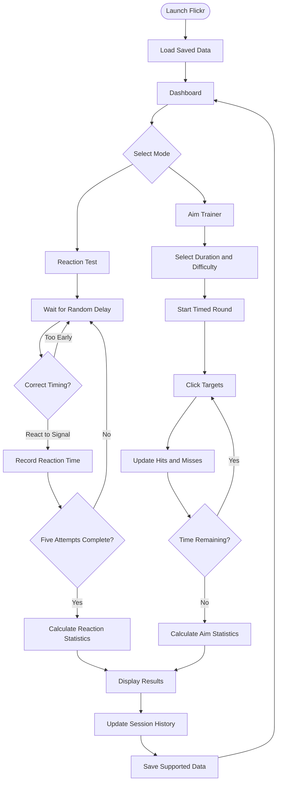

# Flickr — Reaction & Aim Trainer

**Train your reflexes. Sharpen your aim. Track every millisecond.**

Flickr is a browser-based reaction time and aim training application built with React. It helps users test their reflexes, improve clicking precision, and track their performance through interactive training modes and session statistics.

The project combines game logic, real-time interactions, performance tracking, and a clean user interface in one lightweight web application.

## ✨ Features

### ⚡ Reaction Time Test
- Test your reaction speed with randomized waiting periods.
- Respond as quickly as possible when the screen turns green.
- Detect early clicks and provide immediate feedback.
- Track reaction times across five attempts.
- Calculate average and best reaction times.

### 🎯 Aim Trainer
- Practice clicking targets within a limited time.
- Choose a training duration and difficulty.
- Track successful hits and missed clicks.
- Calculate accuracy and review performance statistics.

### 📊 Performance Tracking
- View statistics for completed training sessions.
- Track personal bests and previous results.
- Review session history.
- Persist supported data using browser local storage.

### 🎨 User Interface
- Clean, modern interface built with Tailwind CSS.
- Reusable React components.
- Dedicated layouts for reaction and aim training.
- Responsive design for different screen sizes.

## 🛠️ Tech Stack

| Technology | Purpose |
|---|---|
| React | Component-based UI and application state |
| JavaScript | Game logic and interactions |
| Vite | Development server and build tooling |
| Tailwind CSS | Styling and responsive layouts |
| React Hooks | State management and reusable logic |
| Browser APIs | Timing, animation, and user interaction |
| Local Storage | Persistent session data |

## 🚀 Getting Started

Follow these steps to run Flickr locally.

### Prerequisites

Make sure you have installed:
- [Node.js](https://nodejs.org/)
- npm, included with Node.js
- Git (optional, for cloning the repository)

### 1. Clone the repository

```bash
git clone <your-repository-url>
cd flickr
```

Replace `<your-repository-url>` with your GitHub repository URL.

### 2. Install dependencies

```bash
npm install
```

Install the project's styling and icon dependencies if they are not already included:

```bash
npm install tailwindcss @tailwindcss/vite lucide-react
```

### 3. Start the development server

```bash
npm run dev
```

Open the local URL shown in your terminal, usually `http://localhost:5173`.

### 4. Build for production

```bash
npm run build
```

To preview the production build locally:

```bash
npm run preview
```

## 🎮 How to Use

### Reaction Mode

1. Select **Reaction** from the mode switcher.
2. Start a new test.
3. Wait for the play area to turn green.
4. Click as quickly as possible after the signal.
5. Avoid clicking before the signal appears.
6. Complete all five attempts to see your results.

### Aim Mode

1. Select **Aim** from the mode switcher.
2. Choose your preferred duration and difficulty.
3. Start the training round.
4. Click as many targets as possible before time runs out.
5. Review your hits, misses, and accuracy.

### Review Your Progress

After completing a round, review the displayed statistics and saved session history. Where supported, Flickr retains results in local storage so they can remain available after refreshing the page.

## 🔄 Application Flow


---


## 📁 Project Structure


The application is organized by shared components, individual training features, reusable hooks, and utility functions.

```text
flickr/
├── public/
│   └── projects/
├── src/
│   ├── components/
│   │   ├── Header.jsx
│   │   ├── HistoryPanel.jsx
│   │   ├── ModeSwitcher.jsx
│   │   ├── SettingsPanel.jsx
│   │   └── StatCard.jsx
│   ├── features/
│   │   ├── reaction/
│   │   │   ├── ReactionPlayfield.jsx
│   │   │   ├── ReactionTrainer.jsx
│   │   │   └── useReactionTest.js
│   │   └── aim/
│   │       ├── AimPlayfield.jsx
│   │       ├── AimTrainer.jsx
│   │       └── useAimTrainer.js
│   ├── hooks/
│   │   └── useLocalStorage.js
│   ├── utils/
│   │   ├── formatters.js
│   │   └── storage.js
│   ├── App.jsx
│   ├── index.css
│   └── main.jsx
├── index.html
├── package.json
├── vite.config.js
└── README.md
```

*The tree describes the intended structure; adjust it to match your actual repository.*

## 🧠 What I Learned

Building Flickr was an opportunity to explore interactive application development with React.

- **React state management:** Representing game phases and keeping the UI synchronized with game logic.
- **Refs and timing:** Using refs for values that do not need to trigger rerenders, such as timing references.
- **Timer management:** Handling delayed actions and cleaning up timers when components unmount.
- **Animation loops:** Using browser animation APIs to update time-sensitive gameplay.
- **Component architecture:** Separating shared UI, training modes, and game logic into maintainable modules.
- **Data persistence:** Saving and retrieving supported application data with local storage.
- **Performance metrics:** Calculating reaction times, hit rates, and other round statistics.

## 🔮 Future Improvements

- Add sound effects and optional audio feedback.
- Introduce more training modes and challenge variations.
- Add charts to visualize performance trends over time.
- Support keyboard controls throughout the application.
- Add user profiles and cloud-based progress synchronization.
- Improve accessibility and mobile interaction support.
- Add automated tests for game logic and timing behavior.
\
## 👨‍💻 Author

**Avinash**

- Portfolio: `avinashp.com`
- GitHub: `https://github.com/avinashp026`
- LinkedIn: `www.linkedin.com/in/avinash-prasad-dev`

## 📄 License

This project is available under the MIT License. If you choose this license, add a `LICENSE` file containing the MIT License text and your copyright information.

---

*Built as a hands-on exploration of React, interactive game logic, and performance-focused UI development.*
